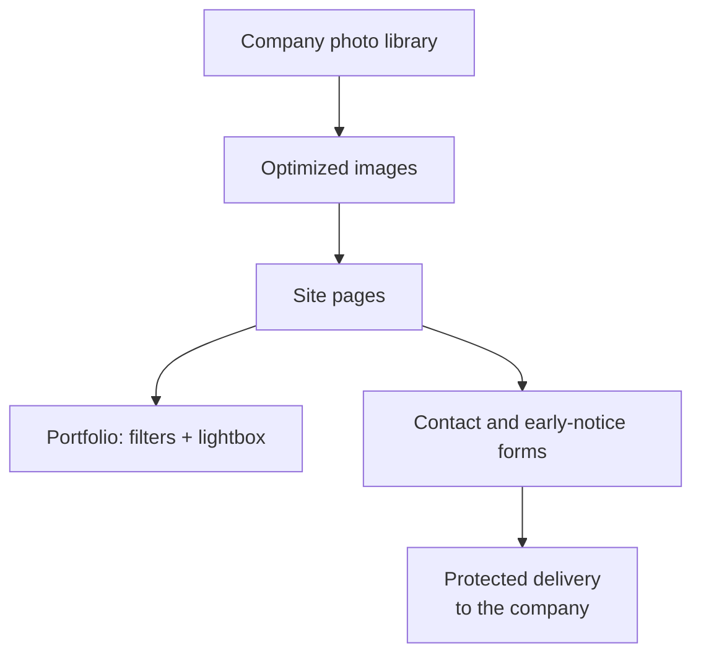

  

<h1 align="center">Higgins Building Group</h1>

<strong>A complete website rebuild for a custom home builder whose best work was hidden at thumbnail size.</strong>

  &nbsp;
  &nbsp;
  

Live · Client project through Higgins Digital · Designed and built by Davis Higgins

---

## See it in motion

  

Real capture of the live portfolio page, showing filters and the lightbox. <a href="assets/demo.png">Static frame</a>

## What it does

- **Lets the homes do the selling.** The company's own project photography runs full width across the site, and a filterable portfolio (all, exterior, interior) opens each photo in a full-screen lightbox.
- **Explains how a build works.** A five-stage process page takes a homeowner from first conversation to final walkthrough, alongside pages for available properties and client testimonials.
- **Makes the first conversation easy.** "Begin a conversation" sits in the header on every page, and the contact and early-notice forms go straight to the company.

## The brief

Higgins Building Group had years of finished custom homes and the photography to prove it. The old site showed that work at thumbnail scale inside a dated layout, so the strongest asset the business owned was the thing visitors saw least, and a homeowner couldn't quickly tell what the company built or how to start.

The direction was to let the photography carry the page, organize the content around how homeowners actually look for a builder, and make the first impression match the quality of the construction.

> "Davis took our old website and turned it into something that finally feels like Higgins Building Group. The new site is cleaner, faster, and much more professional."
>  — Owner, Higgins Building Group

## What I built

- A full rebuild of the site structure: home, about, portfolio, process, properties, testimonials, and contact
- An optimized image library and a rebuilt portfolio with filters and a lightbox
- A navy-and-gold design system drawn from the company's logo, with serif display type and a mobile-first layout
- Contact and early-notice forms with protected email delivery
- Search-ready metadata and structured data, plus accessibility and reduced-motion passes
- A final revision round worked directly from the owner's change list

<strong>How it's put together</strong>

 

| Decision | Why |
|---|---|
| **Photography at full width, without the weight** | Every photo is prepared for the web and served at the right size for the device, so the work looks its best on a phone without a slow page. |
| **Navigation that never stalls** | Page transitions were rebuilt so moving between pages is always smooth and never leaves a blank screen. |
| **Forms that stop spam quietly** | Inquiries are protected from abuse without making real homeowners solve a puzzle. |

## Screens

<table>
  <tr>
    <td width="62%"></td>
    <td rowspan="2" width="38%" align="center"></td>
  </tr>
  <tr>
    <td></td>
  </tr>
</table>

Homepage · Build process · Homepage on mobile

## Technology

| Layer | Technology |
|---|---|
| Framework | Next.js, React, TypeScript, Tailwind CSS |
| Motion | Framer Motion, GSAP, Lenis |
| Hosting | Vercel |

---

  &nbsp;
  

© 2026 Davis Higgins. The Higgins Building Group name, logo, and project photography belong to Higgins Building Group, Inc.

