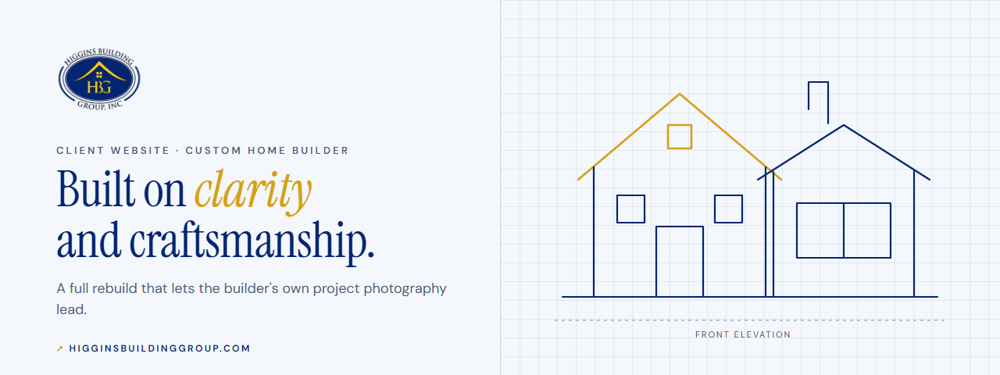
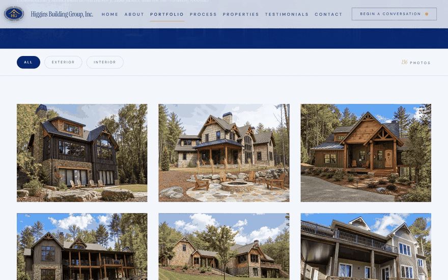
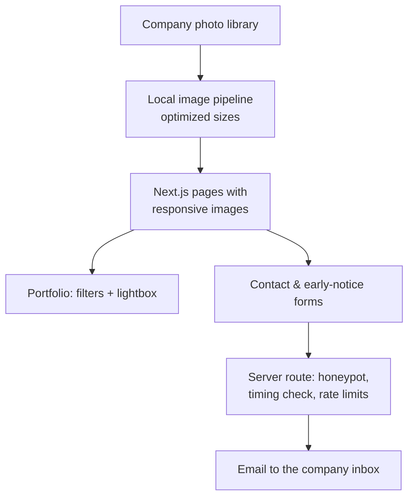
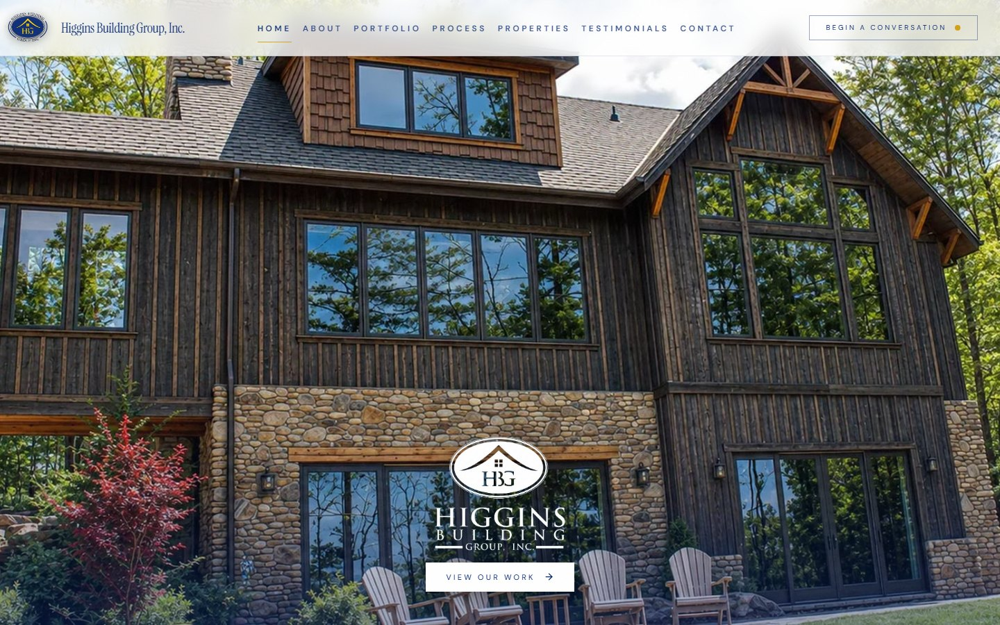
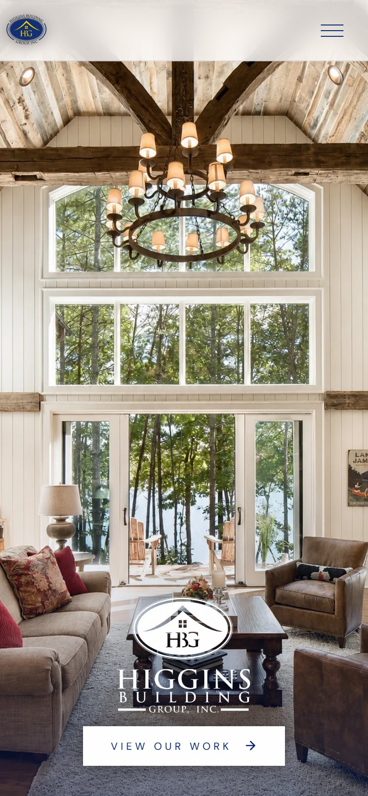
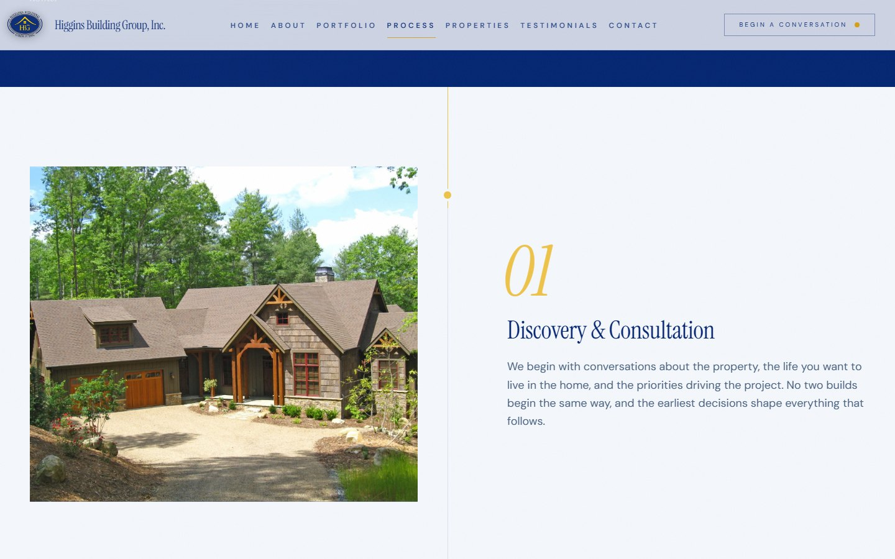

  

<h1 align="center">Higgins Building Group</h1>

  <strong>A complete website rebuild for a custom home builder whose best work was hidden at thumbnail size.</strong> 
  <a href="https://www.higginsbuildinggroup.com"><strong>Visit the site ↗</strong></a> · <a href="https://www.higginsd.com/work/higgins-building-group">Case study</a> · <a href="https://davishiggins.com">Davis Higgins</a>

Live · Client project for Higgins Building Group, Inc. through Higgins Digital · Designed and built by Davis Higgins

---

## See it in motion

  

Real capture of the live portfolio page, showing filters and the keyboard-friendly lightbox. <a href="assets/demo.png">Static frame</a>

## What it does

- **Lets the homes do the selling.** The company's own project photography runs full width across the site, and a filterable portfolio (all, exterior, interior) opens each photo in a full-screen lightbox.
- **Explains how a build works.** A five-stage process page takes a homeowner from first conversation to final walkthrough, alongside pages for available properties and client testimonials.
- **Makes the first conversation easy.** "Begin a conversation" is in the header on every page, and the contact and property early-notice forms go straight to the company's inbox.

## The brief

Higgins Building Group had years of finished custom homes and the photography to prove it. The old site showed that work at thumbnail scale inside a dated layout, so the strongest asset the business owned was the thing visitors saw least. The structure didn't help either: a homeowner couldn't quickly tell what the company built or how to start.

The direction was to let the photography carry the page, organize the content around how homeowners actually look for a builder, and make the first impression match the quality of the construction.

> "Davis took our old website and turned it into something that finally feels like Higgins Building Group. The new site is cleaner, faster, and much more professional."
>  — Owner, Higgins Building Group (from the testimonial published at higginsd.com)

## What I built

- Full rebuild of the site structure and page hierarchy: home, about, portfolio, process, properties, testimonials, and contact
- A local image pipeline for the company's photo library and a rebuilt portfolio with filters and a lightbox
- A navy-and-gold design system sampled from the company's logo, with serif display type and a mobile-first layout
- Contact and early-notice forms with email delivery and abuse protection
- SEO metadata, structured data, a sitemap, and accessibility and reduced-motion passes
- A final revision round working directly from the owner's change list

## How it's put together

### Engineering decisions

| Decision | Why |
|---|---|
| **An image pipeline instead of raw uploads** | The portfolio's photos are processed into optimized files and served as responsive images. The photography can run full width on a phone without forcing visitors to download originals. |
| **Entrance-only page transitions** | An exit animation wrapped around server-rendered pages could leave the screen blank after navigation, because the outgoing page was already gone. I replaced it with a short entrance-only transition, fixed the same stuck-exit pattern in the lightbox and testimonial carousel, and reset scroll position on every route change. |
| **Forms that resist spam without a CAPTCHA** | The contact route uses a hidden honeypot field, a minimum fill time, and per-address and server-wide rate limits before sending a structured email. Real homeowners never see a puzzle. |

The colors are sampled from the company's own logo rather than chosen fresh. Navy replaces pure black everywhere, and gold is reserved for emphasis.

## Screens

<table>
  <tr>
    <td width="62%"></td>
    <td rowspan="2" width="38%" align="center"></td>
  </tr>
  <tr>
    <td></td>
  </tr>
</table>

Homepage · Build process · Homepage on mobile

## Technology

| Layer | Technology | Responsibility |
|---|---|---|
| Framework | Next.js 16 (App Router), React, TypeScript, Tailwind CSS | Pages, routing, responsive images |
| Motion | Framer Motion, GSAP, Lenis | Page entrances, reveals, smooth scroll |
| Forms | React Hook Form, zod, Resend | Validation and email delivery |
| Hosting | Vercel | Deployment |

## Status

- **Live** at higginsbuildinggroup.com, with the owner's final revision list implemented.
- **No invented results.** This showcase describes the rebuild's scope. No traffic or inquiry numbers have been measured for publication.

## About this repository

This is a documentation-only showcase. The site's source and the company's full photo library aren't included here. The screenshots show the public site at screen resolution only.

**[Visit the site ↗](https://www.higginsbuildinggroup.com)** · Built by [Davis Higgins](https://davishiggins.com) · [More of my work](https://github.com/DavisHiggins)

© 2026 Davis Higgins. Screenshots are shared for portfolio viewing with the client's work credited. The Higgins Building Group name, logo, and project photography belong to Higgins Building Group, Inc.
